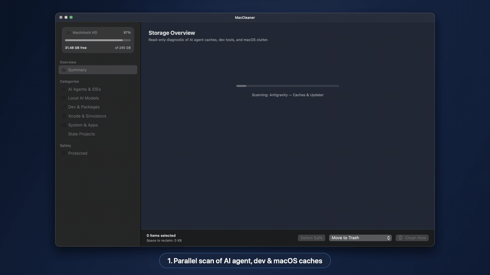

# MacCleaner

Native macOS disk cleaner engineered with **Swift 6** and **SwiftUI** — purpose-built to safely reclaim gigabytes lost to **AI coding agent caches**, **local LLM models**, **package managers**, **Xcode simulators**, and **stale project dependencies**.


[](media/maccleaner-demo-en.mp4)

<p align="center">
  <a href="media/maccleaner-demo-en.mp4">▶ Watch full 1080p @ 30fps MP4 demo</a>
</p>

---

## Why I Built MacCleaner

When working daily with AI coding agents, local LLMs, and multiple toolchains on macOS, tens of gigabytes silently accumulate in hidden directories (`~/.npm/_cacache`, `~/.cache/huggingface`, `~/.ollama`, DerivedData, browser automation binaries, and orphaned `node_modules` / `.venv` folders) that generic cleaner utilities ignore.

MacCleaner inspects all developer and AI targets in parallel, enforces strict programmatic path safety guarantees, requires an explicit **Dry-Run Confirmation** before touching a single byte, and moves items to the **macOS Trash** by default so every cleanup stays recoverable.

---

## Cleanup Rule Catalog (6 Categories)

| Category | Targets Covered |
| --- | --- |
| **AI Agents & IDEs** | Antigravity caches & browser recordings/sessions, Gemini CLI temp/cache, Claude Code caches/backups/debug logs & project sessions, Codex, Cursor, VS Code, Windsurf |
| **Local AI Models** | HuggingFace Hub cache, Ollama models, LM Studio models |
| **Developer Package Caches** | `npm`, `pnpm`, `bun`, `yarn`, `pip`, `uv`, Homebrew, SwiftPM, Playwright, Puppeteer, Cargo, Gradle, CocoaPods |
| **Xcode & Mobile** | `DerivedData`, Xcode caches, CoreSimulator caches & simulator devices |
| **System & Apps** | User `~/Library/Caches`, user `~/Library/Logs`, old installer packages in `~/Downloads` |
| **Stale Project Artifacts** | Dormant `node_modules` and Python `.venv` folders inside projects untouched past a configurable staleness window (default 30 days) |

---

## Safety-First Architecture

- **3 Risk Tiers:** Separates 100% recreatable caches (**Safe**), re-downloadable assets (**Moderate**), and manual review items like AI conversation history or downloaded model weights (**Manual Review**).
- **Mandatory Dry-Run Preview:** No file deletion can ever occur without first reviewing the itemized preview sheet showing every exact path, item count, and byte total.
- **Trash by Default:** Moves items via `FileManager.trashItem` so everything can be restored from macOS Trash. Permanent deletion requires an explicit opt-in toggle with prominent confirmation warnings.
- **Hardcoded `SafetyGuard` Rails:**
  - Blocks system roots (`/`, `/System`, `/usr`, `/bin`, `/sbin`, `/Library`, `/Applications`, `/Users`) and critical user roots (`~`, `~/Desktop`, `~/Documents`, `~/Downloads`, `~/Library/Keychains`, `~/.ssh`, `~/.gnupg`, `~/.aws`).
  - Protects sensitive filenames by component (`.env`, `.env.local`, `.env.production`, `credentials`, `credentials.json`, `settings.json`, `auth.json`, `id_rsa`, `id_ed25519`, `known_hosts`, `login.keychain-db`).
  - Validates resolved parent symlinks to block directory-traversal or symlink escapes into protected roots.
- **Custom Whitelist (`ExclusionsStore`):** Protect any folder or path directly from the UI (shield icon or **Protected** tab).

---

## Project Structure

```text
├── Package.swift                               # Swift 6.0 SPM manifest (macOS 14+)
├── Sources/
│   ├── MacCleanerCore/                         # Core scanning & safety engine library
│   │   ├── RuleCatalog.swift                   # Built-in 6-category developer/AI rules
│   │   ├── SafetyGuard.swift                   # Immutable path, filename & symlink validator
│   │   ├── ScannerEngine.swift                 # Parallel disk scanner
│   │   ├── CleanerEngine.swift                 # Trash & permanent deletion execution engine
│   │   ├── ExclusionsStore.swift               # User-managed whitelist persistence
│   │   ├── Localization.swift                  # EN / PT-BR localization helper
│   │   └── Models.swift                        # Scan summary, categories, risk tiers & reports
│   └── MacCleaner/                             # Native SwiftUI app + MenuBarExtra
│       ├── MacCleanerApp.swift                 # App entry point, MenuBarExtra & CLI --scan-summary
│       ├── OverviewView.swift                  # Disk overview & Swift Charts breakdown
│       ├── CategoryDetailView.swift            # Rule inspector & per-target selection
│       ├── DryRunConfirmationSheet.swift       # Mandatory dry-run verification modal
│       ├── CleanResultSheet.swift              # Post-clean summary & freed-space report
│       ├── ExclusionsView.swift                # Whitelist manager
│       └── DemoRecorder.swift                  # Scripted 1080p demo frame exporter
├── Tests/
│   └── MacCleanerCoreTests/
│       └── MacCleanerCoreTests.swift           # Isolated Swift Testing suite in temp sandboxes
└── scripts/
    ├── build-app.sh                            # Builds release binary & packages MacCleaner.app
    └── test.sh                                 # Runs unit tests with Swift Testing macros plugin
```

---

## Getting Started

### Requirements
- **macOS 14 (Sonoma)** or later
- **Swift 6.0+** (Xcode or Command Line Tools)

### 1. Build & Launch the `.app` Bundle

```bash
git clone https://github.com/leonardogtcruz1/mac-cleaner.git
cd mac-cleaner
./scripts/build-app.sh
open build/MacCleaner.app
```

> **Note:** Build scripts pass `--scratch-path "${TMPDIR:-/tmp}/mac-cleaner-build"` so Finder/iCloud Drive extended attributes inside `.build` never interfere with `codesign`.

### 2. Run Directly via SwiftPM

```bash
swift run --scratch-path /tmp/mac-cleaner-build MacCleaner
```

### 3. Read-Only CLI Diagnostic Scan

```bash
build/MacCleaner.app/Contents/MacOS/MacCleaner --scan-summary
```

### 4. Run Unit Tests

```bash
./scripts/test.sh
```

---

## Permissions Note

- **Full Disk Access (Optional):** Certain sandboxed or protected locations under `~/Library` require enabling **System Settings → Privacy & Security → Full Disk Access** for MacCleaner. Any unreadable items are safely reported and skipped without interrupting the scan.

---

## Tech Stack

| Layer | Technologies |
| --- | --- |
| **Language** | Swift 6.0 (`Sendable` strict concurrency) |
| **UI & Visualization** | SwiftUI (`NavigationSplitView`, `MenuBarExtra`), Swift Charts |
| **System & Testing** | Foundation (`FileManager.trashItem`), AppKit, Swift Testing |

---

## Author

**Leonardo Cruz** — [GitHub](https://github.com/leonardogtcruz1)
